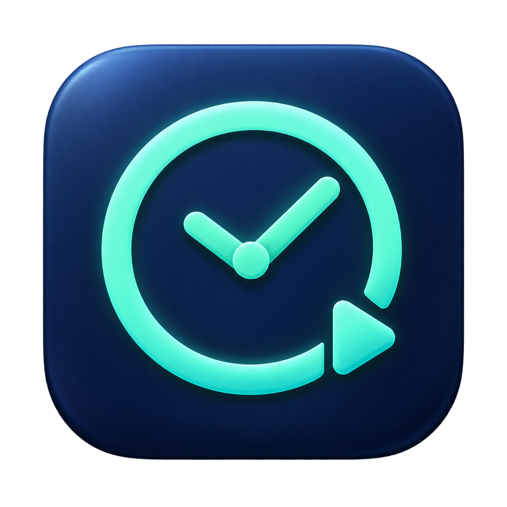
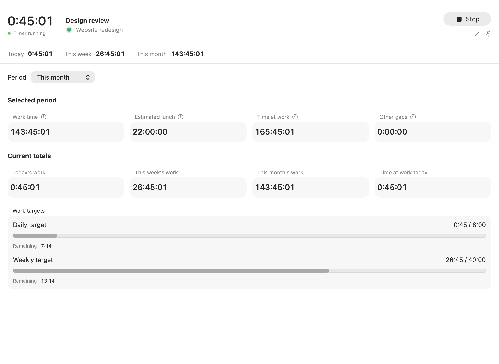

  

<h1 align="center">Fluidtime</h1>

  <strong>Your time, one click away.</strong> 
  A native macOS app for Solidtime.

  <strong>macOS 14+</strong> &nbsp;·&nbsp; <strong>Native SwiftUI</strong> &nbsp;·&nbsp; <strong>Your Solidtime instance</strong>

  <a href="https://github.com/MateeDevs/fluidtime/releases/latest"><strong>Download Fluidtime</strong></a> &nbsp;·&nbsp;
  <a href="docs/installation.md">Install</a> &nbsp;·&nbsp;
  <a href="docs/usage.md">User guide</a> &nbsp;·&nbsp;
  <a href="docs/development.md">Build from source</a>

Fluidtime keeps your Solidtime timer, entries, and workday insights close in a native Mac window and menu bar.

  

- **Track without breaking focus.** Start, stop, and switch tasks from the menu bar or customizable global shortcuts.
- **See your day add up.** Follow live totals, work targets, charts, and daily timelines.
- **Keep entries organized.** Search and filter your history, edit entries, and pin tasks you return to often.
- **Understand your workday.** Explore work patterns, estimated lunch gaps, and period comparisons. Export entries or daily summaries as CSV.
- **Keep earnings private.** Reveal estimates with Touch ID. Your rate stays in Keychain and out of CSV exports.
- **Use your own Solidtime.** Connect your instance and organization with an API key stored in macOS Keychain.
