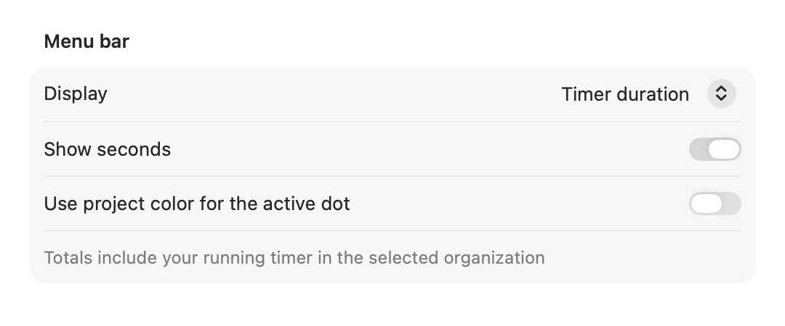
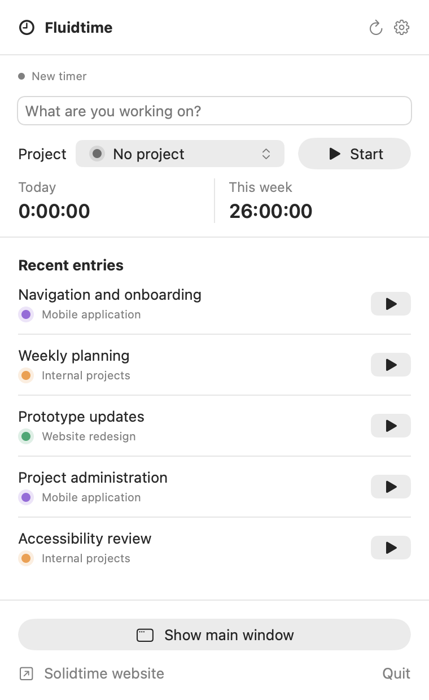
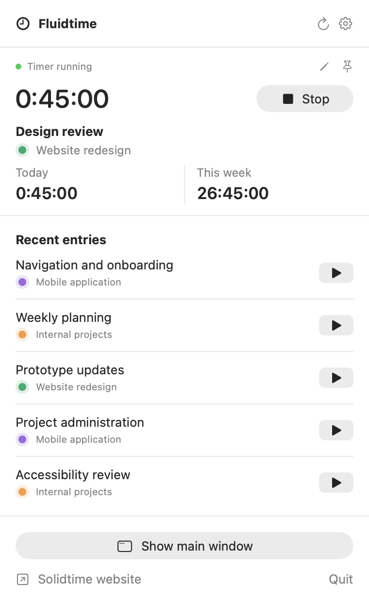
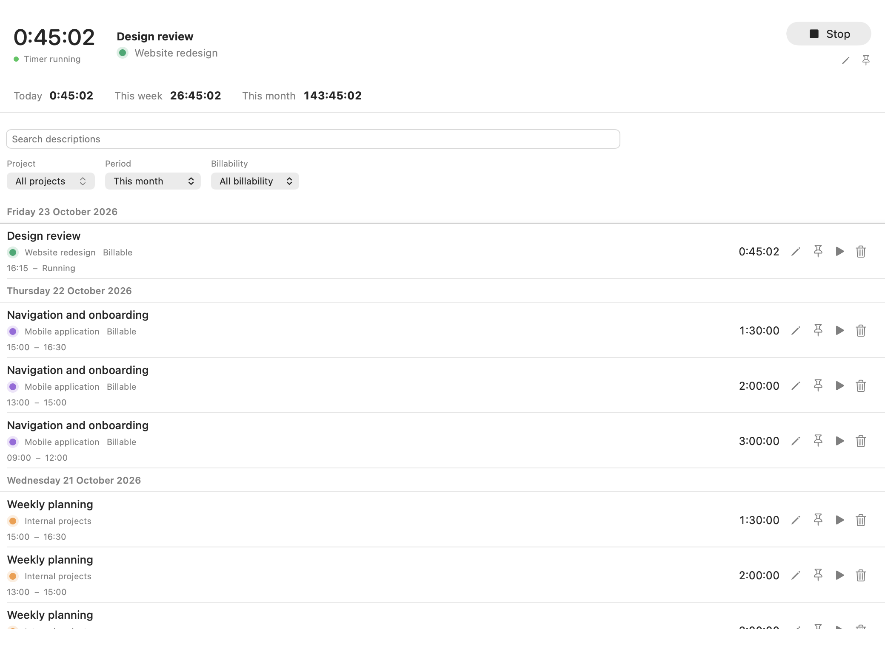
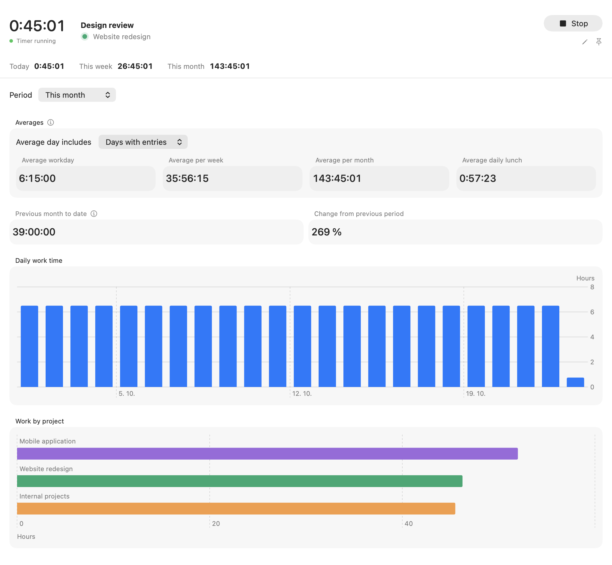
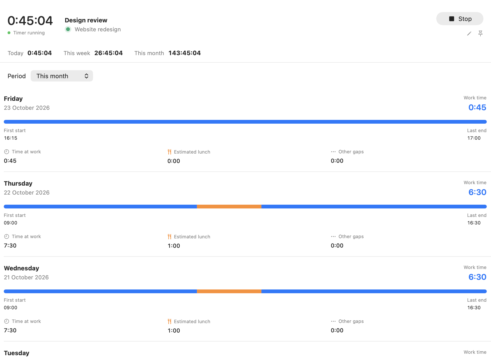

# Using Fluidtime

1. Open Fluidtime from your menu bar and select **Connect to Solidtime**.
2. In **Account** settings, enter your Solidtime address and an API key from your Solidtime account settings, then select **Connect**.
3. Choose your organization in **Tracking** settings.
4. Add a description, choose a project, and select **Start timer**.

Use **Open Solidtime** whenever you need the full web app. Quitting Fluidtime leaves any running timer active on Solidtime.

## Features

| Make time for your work | Fluidtime takes care of the tracking |
| --- | --- |
| **Start, stop, and switch** | Track a new task or start from one of your five most recent entries. Switching stops the current timer before starting a new one. |
| **See your progress** | Today's, this week's, and this month's main-window totals include your running timer, using your Solidtime account's time zone and week start. |
| **Keep entries accurate** | Edit descriptions, projects, times, and billability in an anchored popover. Browse continuous, filterable history and delete entries after confirmation. |
| **Choose your menu bar** | Show the timer duration, today's total, this week's total, a timer status dot, or just the clock icon. Show or hide seconds, and optionally color the active dot using the running project. |
| **Reach it from anywhere** | Toggle the menu with a customizable global keyboard shortcut, and choose whether Fluidtime launches at login. |
| **Connect your account** | Use your Solidtime address and API key, then choose an organization. Your key stays in macOS Keychain. |
| **Keep both views close** | Switch between Overview, Time entries, Analysis, and Daily details in the main window. The menu bar remains available. Search projects and pin tasks you return to often. |
| **Understand your workday** | See day, week, and month totals, charts, daily details, averages, work targets, and a comparison with the previous period. Choose a date range and export entries or daily summaries as CSV. |
| **Understand lunch time** | Lunch is an estimate from the longest gap between work entries whose midpoint falls between 11:00 and 15:00 in your Solidtime time zone. Change those hours in Workspace settings. Lunch appears after work resumes and never creates a timer entry. |
| **Keep earnings private** | Enable earnings in Settings, then use Touch ID to reveal today’s and the selected period’s estimates. Earnings are off by default. Set one fixed hourly rate and currency in Earnings settings; the rate stays in Keychain on your Mac. There is no rate history, and CSV exports never contain private values. |
| **Keep your timer in view** | Start or stop from another app with a shortcut and get a brief on-screen confirmation. Optional idle and long timer reminders ask you to review your entry. |

## Make it yours

Native settings keep your account, tracking preferences, menu bar display, and startup options together.

  

The default shortcut to open Fluidtime is **Control–Option–Shift–Command–F** (`⌃⌥⇧⌘F`). **Control–Option–Shift–Command–T** (`⌃⌥⇧⌘T`) starts or stops your timer. Starting uses your most recent completed work entry. Change either shortcut in **Settings → Menu bar**.

Configure work targets, lunch hours, and reminders in **Settings → Workspace**. The main window and menu bar are both available. The Dock icon appears while the main window or Settings is open. Launch at login starts in the menu bar without opening the main window.

Time at work spans the first work entry start to the last work entry end each day, or now while work runs. It includes estimated lunch and other gaps. Earnings use tracked work only, so lunch is not deducted a second time.

Set the fixed preview rate in **Settings → Earnings** after Touch ID verification. Changing it applies to every preview period. Each reveal requires Touch ID; hiding a value, leaving its view, closing its window, locking the Mac, or sleep clears access. Macs without available Touch ID keep private values hidden.

## Screenshots

<table>
  <tr>
    <th>Ready for your next task</th>
    <th>A timer in progress</th>
  </tr>
  <tr>
    <td align="center"></td>
    <td align="center"></td>
  </tr>
</table>

  
Explore Time entries, Analysis, and Daily details

  
<strong>Time entries</strong>

  

  
<strong>Analysis</strong>

  

  
<strong>Daily details</strong>

  

[Installation](installation.md) · [Back to Fluidtime](../README.md)
